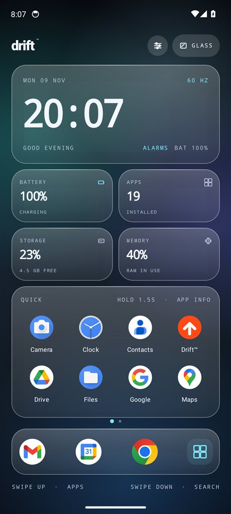
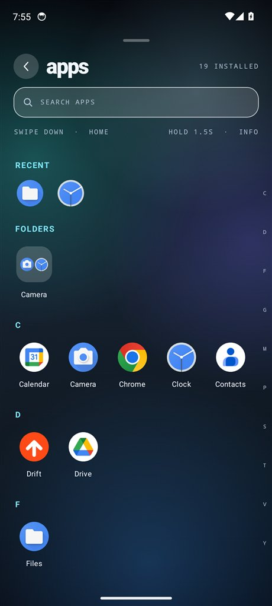
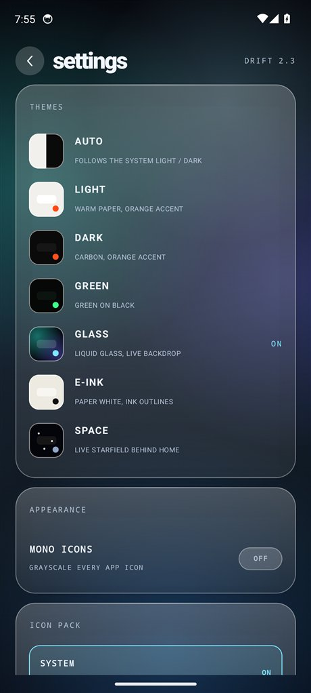

# Drift™

**A gesture-first Android home screen with nineteen themes, widgets, icon packs
and three app-drawer layouts.**

Android 8.0+ · v2.5 · by Athul R Nair · signed release build

[**Download Drift 2.5**](../../releases/latest) · [Changelog](CHANGELOG.md) ·
[Report a problem](../../issues)

| Home — GLASS | App drawer | Themes |
| --- | --- | --- |
|  |  |  |

Drift replaces your home screen with a large clock, pickable stat cards, a
foldered app drawer, widgets on a second page, icon-pack support and direct
control over the display refresh rate. Everything runs on the device: Drift
holds no internet permission, has no analytics, and needs no account.

## Install

1. Open the [latest release](../../releases/latest).
2. Download **Drift-2.5-release.apk**.
3. Open the file on the phone and allow "install unknown apps" for your browser
   or file manager when Android asks.
4. Open Drift, then **Settings → SET AS DEFAULT LAUNCHER**, or Android Settings →
   Apps → Default apps → Home app → Drift.

The APK is signed with a release key and shrunk with R8. It installs alongside
any other launcher and can be removed the usual way.

Drift also checks its own signing certificate at launch. A copy that was
repackaged and signed with a different key shows a **MODIFIED COPY** notice
instead of the launcher, with a button to open its app settings.

## What it does

**Home**
- Large clock (tap for alarms), up to four pickable stat cards, a quick-apps
  panel, a four-app dock and a settings button.
- Double tap empty space to turn the screen off — optional, and the only use of
  device admin (the single `force-lock` policy).
- Edge lighting: both screen edges glow for about three seconds when a
  notification arrives, in blue, red or amber, optionally for calls too.
- Unread-count badges on app icons, fed by the notification listener.

**App drawer**
- Three layouts: **GRID** (one scrolling A–Z grid with a letter scrubber),
  **PAGES** (fixed screens swiped sideways, with page dots) and **LIST** (one
  app per row with its package name).
- Search inside the drawer, folders, recents, hidden apps, app labels on/off
  and sort by name or most used.
- Hold any icon for 1.5 s for the app sheet: shortcuts, OPEN, APP INFO, HIDE APP
  and UNINSTALL.

**Page 2**
- System widgets from any installed app, torch, Wi-Fi/Bluetooth/sound/battery
  shortcuts, refresh-rate mode and the gesture map.

**Performance**
- Refresh-rate control: **SMART**, **MAX** (fastest mode the panel advertises)
  and **60HZ**.
- **HZ PROBE** measures the frames Android actually delivers.
- **LITE MODE** drops shadows and gradients and halves slide times.

## Themes

| Theme | Look | Live backdrop |
| --- | --- | --- |
| AUTO | Follows the system light/dark setting | — |
| LIGHT | Warm paper, one hot orange accent | — |
| DARK | Carbon black, orange accent | — |
| GREEN | Mint text and a vivid green accent on black | — |
| E-INK | Paper white, ink outlines, round grayscale icons | — |
| SPACE | Deep navy sky, drifting stars, shooting stars | ✓ |
| GLASS | Translucent milk-white panes over moving liquid colour | ✓ |

### Hero themes

Twelve colour palettes with a drawn motif backdrop behind home, drawer, search
and settings. They are colour and shape studies only — no film stills, logos or
third-party artwork ship in the APK, and they are not official products.

| Theme | Look | Backdrop |
| --- | --- | --- |
| SPIDER-MAN | Crimson accent on midnight blue, a web in the corner | ✓ |
| IRON MAN | Gold on crimson, a pulsing arc-reactor glow | ✓ |
| BATMAN | Signal yellow on black, a bat emblem low on the screen | ✓ |
| SUPERMAN | Blue and red, a shield outline over a cape wash | ✓ |
| WOLVERINE | Yellow on charcoal, three claw slashes | ✓ |
| DEADPOOL | Red on oxblood, two white mask slits | ✓ |
| BLACK PANTHER | Violet accent on black, a hexagon weave | ✓ |
| SCARLET WITCH | Crimson, three hex rings and a glowing core | ✓ |
| THOR | Storm blue, a lightning bolt | ✓ |
| HULK | Green, cracks running out from an impact point | ✓ |
| CAPTAIN AMERICA | Navy and red, shield rings bottom-right | ✓ |
| FLASH | Yellow speed streaks across the screen | ✓ |

## Gestures

| Gesture | Result |
| --- | --- |
| Swipe up on home | app drawer |
| Swipe down on home | search |
| Swipe left / right | previous / next page |
| Swipe down at drawer top or header | home |
| Hold an icon 1.5 s | app sheet and shortcuts |
| Tap the clock | alarms |
| Double tap empty home space | screen off, if enabled |

## Permissions, and why

| Permission | Used for | Optional |
| --- | --- | --- |
| `QUERY_ALL_PACKAGES` | Listing every installed app so the drawer is complete | No |
| `VIBRATE` | Haptic ticks on taps and holds | No |
| `ACCESS_NETWORK_STATE` | Knowing whether a web search can open | No |
| Notification listener | Unread badges and edge lighting | Yes |
| `SYSTEM_ALERT_WINDOW` | Drawing edge lighting over other apps | Yes |
| Device admin (`force-lock`) | Double tap to turn the screen off | Yes |

Drift declares **no `INTERNET` permission**, so it cannot upload anything. There
are no ads, no analytics SDKs and no accounts. Settings, hidden apps, folders and
layout choices stay in the app's own storage on the phone.

## Compatibility and status

- Android 8.0 (API 26) and newer; built and targeted against API 34.
- Tested on a Pixel 6 emulator running Android 14 at 1080×2400. Real-phone
  high-refresh behaviour and live-backdrop battery cost are not measured.
- Not on Google Play. Updates are posted here as new releases.

## Legal

- Copyright © 2026 Athul R Nair. All rights reserved.
- Drift™ is a trademark of Athul R Nair.
- Downloading the APK grants a personal licence to install and use it on devices
  you own — not ownership, and not the right to redistribute, rebrand or resell
  the app. See [LICENSE](LICENSE).
